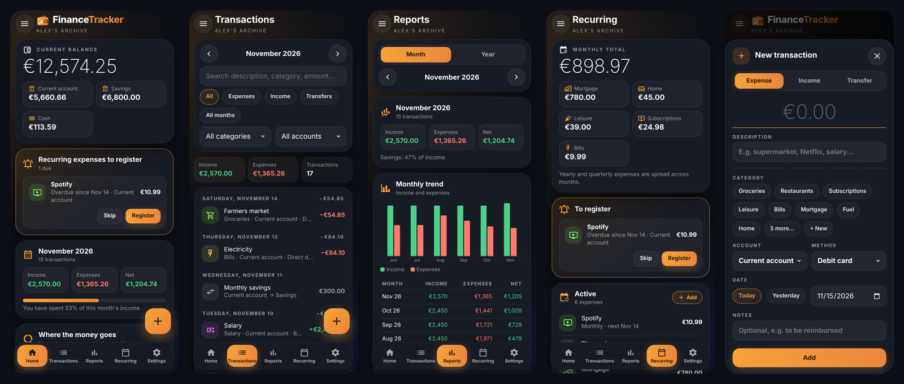
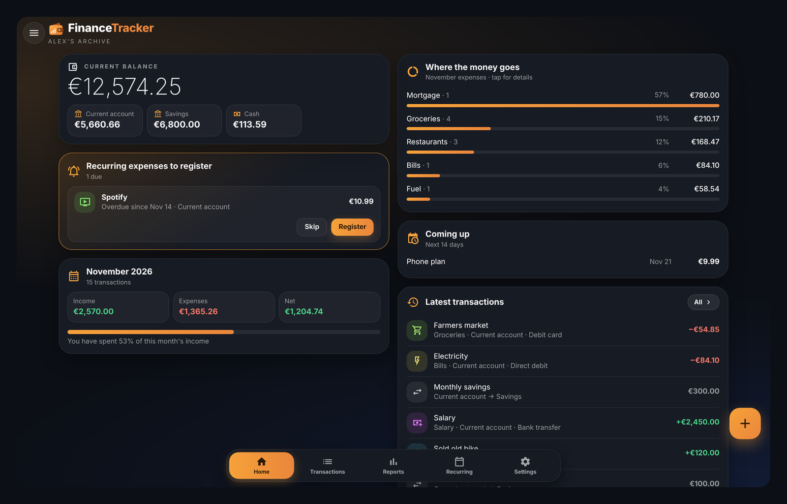
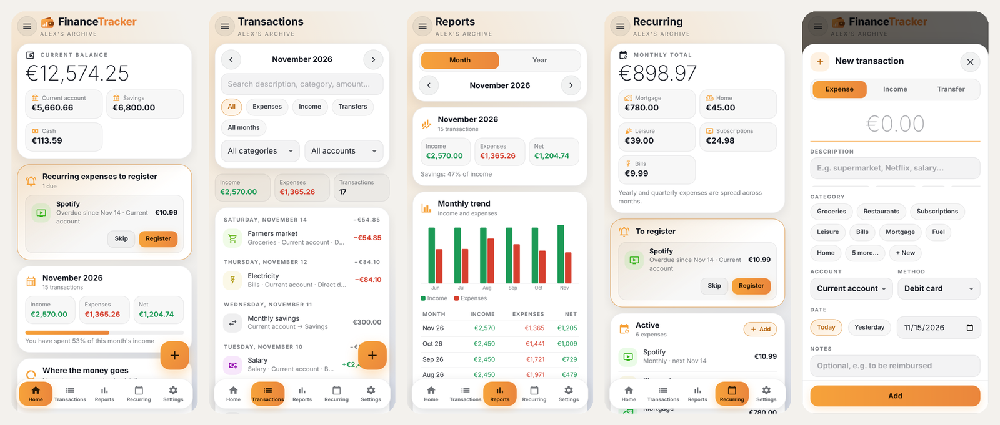
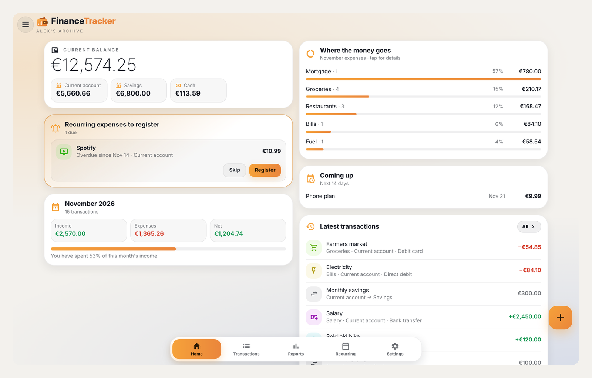

<p align="center">
<picture>
  <source media="(prefers-color-scheme: dark)" srcset="https://raw.githubusercontent.com/Thonno/ha-financetracker/main/custom_components/financetracker/brand/dark_logo@2x.png">
  
</picture>
</p>

# FinanceTracker for Home Assistant

[](https://my.home-assistant.io/redirect/hacs_repository/?owner=Thonno&repository=ha-financetracker&category=integration)
[](https://my.home-assistant.io/redirect/config_flow_start/?domain=financetracker)

A personal finance tracker that lives inside Home Assistant. You log income and expenses by hand – no bank connection, no receipt scanning, no cloud service – and get balances, monthly reports and reminders for recurring payments, from a sidebar panel designed for the Home Assistant Companion app on your phone.

> **Languages:** English and Italian. The panel, the entity names, the notifications and the starter categories follow the language set in Home Assistant (any other language falls back to English). More translations are welcome – see [Contributing](#contributing).

<details>
<summary><b>Dark theme</b></summary>

**Phone**

[](https://raw.githubusercontent.com/Thonno/ha-financetracker/main/docs/screenshots/dark_phone.png)

**Tablet and desktop**

[](https://raw.githubusercontent.com/Thonno/ha-financetracker/main/docs/screenshots/dark_desktop.png)

</details>

<details>
<summary><b>Light theme</b></summary>

**Phone**

[](https://raw.githubusercontent.com/Thonno/ha-financetracker/main/docs/screenshots/light_phone.png)

**Tablet and desktop**

[](https://raw.githubusercontent.com/Thonno/ha-financetracker/main/docs/screenshots/light_desktop.png)

</details>

*Screenshots use made-up demo data.*

## Features

- **Sidebar panel built for phones**: a card-based layout with bottom tab navigation that adapts to phones, tablets and desktops. It works in the Companion app and in any browser.
- **Any currency**: uses the currency set in Home Assistant (*Settings → System → Home information*) by default; each user can pick a different one. Amounts are shown in the right format for your language.
- **Light, dark or automatic theme**: automatic follows your Home Assistant theme; the choice is saved per user and follows you across devices.
- **Fast entry**: type the amount, then tap a category; your most-used categories are shown first. Tapping a past description fills in its category, account and payment method.
- **Accounts and transfers**: track several accounts (current account, savings, cash, PayPal…), each with an opening balance. Transfers between accounts (ATM withdrawals, moving money to savings) change balances but don't count as income or expenses.
- **Transactions**: browse by month, search, and filter by type, category and account. Edit or delete any entry.
- **Reports** by month or year: income vs. expenses over time, spending by category, by payment method and by account, and a dedicated total for mortgage, loans and subscriptions.
- **Interest on savings accounts**: set tiered annual rates per account (e.g. 2.5% up to €3,000, 1% above) and an optional tax withholding; interest is calculated on the end-of-day balance and recorded automatically every day as income.
- **Recurring expenses**: monthly, bimonthly, quarterly, half-yearly or yearly, with an optional last-instalment date. When one is due you get an actionable notification with **Register** / **Skip** buttons; answering on one device clears it everywhere.
- **One private archive per Home Assistant user**: each person who opens the panel sees only their own data (see [Privacy](#privacy-and-multi-user-behaviour)).
- **Optional sensors** for dashboards and automations, enabled per user.
- **Actions** (`financetracker.add_transaction`, `financetracker.register_recurring_expense`) for scripts, automations and voice assistants.
- **Import / export**: JSON backup and restore, CSV export, and a converter for existing spreadsheets.

## Requirements

- Home Assistant 2025.1 or newer
- [HACS](https://hacs.xyz) for the recommended installation
- The Home Assistant Companion app, if you want reminder notifications with action buttons

## Installation

### HACS (recommended)

Click the first button at the top of this page to open the repository directly in your Home Assistant's HACS, then download it and restart. Or do it by hand:

1. In HACS open the menu (⋮) → **Custom repositories**.
2. Add `https://github.com/Thonno/ha-financetracker` with type **Integration**.
3. Search for **FinanceTracker**, download it, then restart Home Assistant.
4. Go to **Settings → Devices & services → Add integration → FinanceTracker** (or click the second button at the top) and choose the time of day for reminders.

### Manual

Copy `custom_components/financetracker` into your Home Assistant `config/custom_components/` folder (for example with the Samba or File editor add-on), restart Home Assistant, then add the integration as in step 4 above.

## First steps

1. Open **FinanceTracker** from the sidebar. The subtitle shows whose archive you are in.
2. Go to **Settings** and set up your accounts with their opening balances, your categories and your payment methods (a new archive starts with a sensible default set).
3. Under **Recurring expense reminders**, tap the devices that should receive your notifications.
4. Add your recurring expenses under **Recurring**, then start logging with the **+** button.
5. Optionally, in **Settings**: pick the panel theme, a currency different from Home Assistant's, and interest rates for your savings accounts (see below).

## Interest on savings accounts

FinanceTracker can record the interest your savings account pays, day by day.

1. Open **Settings → Accounts** in the panel and tap **%** next to the account.
2. Add one or more **tiers**. Each tier has an upper limit and an annual rate; leave the limit empty on the last tier for "everything above". For example:

   | Up to | Annual rate |
   |---|---|
   | 3,000 | 2.5 % |
   | *(empty)* | 1 % |

   With a €5,000 balance this gives 2.5 % on the first €3,000 and 1 % on the remaining €2,000, i.e. €95 gross per year.
3. Set the **tax withheld** (e.g. 26 % in Italy) so recorded amounts are net, and the date to **calculate from**.
4. Save. A preview shows the net daily, monthly and yearly yield on the current balance.

How it works:

- Interest is calculated on each day's **end-of-day balance** (including interest already credited) with the formula *balance × rate ÷ 365*, tier by tier.
- Every night shortly after midnight, an **"Interest earned" income** is recorded on that account for the previous day, with the gross amount and the tax in the notes. If Home Assistant was off, the missing days are caught up at startup; choosing a start date in the past back-fills those days right away.
- Amounts are rounded down to the cent, as banks do; the fraction left over is carried to the next day, so nothing is lost.
- Editing past transactions does not recalculate interest that has already been recorded.

## Privacy and multi-user behaviour

- Each Home Assistant user gets a separate archive, stored in `.storage/financetracker.user_<user id>`. The panel, the actions and the reminders only ever read or write the archive of the signed-in user.
- Notification buttons are only accepted from the user who owns the recurring expense.
- Data stays on your Home Assistant instance and is included in its regular backups.
- **Limitation:** Home Assistant has no per-user encryption. An administrator with access to the configuration files or to a backup can read every archive.
- **Sensors are off by default** because Home Assistant entities are visible to every user. Turn them on only if you are comfortable with that.

## Sensors (optional, per user)

Turn them on in the panel under **Settings → Sensors in Home Assistant**. Each user gets a device called *FinanceTracker &lt;user&gt;*; entity names – and therefore entity IDs – are created in your Home Assistant language, for example `sensor.financetracker_mario_total_balance` in English or `sensor.financetracker_mario_saldo_totale` in Italian.

| Sensor | Value |
|---|---|
| Total balance | Sum of all accounts (attribute with the balance of each account) |
| *&lt;account&gt;* balance | Balance of one account |
| Income this month | |
| Expenses this month | With a per-category attribute |
| Net this month | Income minus expenses |
| Monthly recurring expenses | Monthly total of active recurring expenses |
| Recurring expenses due | Number of recurring expenses waiting to be registered |

## Actions

Both actions write to the archive of the user who runs them. Automations run without a user, so pass `user` with the Home Assistant user name. Only administrators can write to someone else's archive.

```yaml
action: financetracker.add_transaction
data:
  amount: 12.50             # always positive, in your archive's currency
  type: expense             # expense | income | transfer
  category: Groceries
  description: Supermarket
  account: Current account
  method: Debit card
  user: Mario               # only needed in automations
```

```yaml
action: financetracker.register_recurring_expense
data:
  expense: Netflix          # name or id of the recurring expense
  user: Mario
```

Both actions return the created transaction as response data (`transaction`).

## Import and export

From **Settings → Data** in the panel:

- **Export backup (JSON)**: your full archive, minus your personal notification settings.
- **Export transactions (CSV)**: semicolon-separated, opens directly in Excel and LibreOffice.
- **Import and add**: merges a JSON file into your archive.
- **Import and replace everything**: overwrites your archive with the file. Your notification settings are kept.

### Coming from a spreadsheet

`tools/excel_to_financetracker.py` converts an Excel workbook into the JSON import format. It expects sheets named `Movimenti` (transactions), `Liste` (lists of categories, methods, accounts and opening balances) and `Spese fisse` (recurring expenses). Adapt it to your own layout if needed.

```bash
pip install openpyxl
python3 tools/excel_to_financetracker.py my_finances.xlsx financetracker_import.json \
    --principale "Current account" --deposito "Savings"
```

Rows in the `Prelievo` (withdrawal) category become transfers to `Contanti` (cash). With `--principale` and `--deposito`, rows in the `Conto deposito` category become transfers between those two accounts. For recurring expenses, the next due date is worked out from the last matching payment; those with no match are flagged *da verificare* (to check).

The JSON format is simple: `accounts`, `categories`, `methods`, `movements` and `recurring`. Export a backup from the panel to see a complete example.

## Contributing

Issues and pull requests are welcome, especially translations of the panel. The panel is a single dependency-free web component, `custom_components/financetracker/frontend/financetracker-panel.js`; its strings are in the `EN` table at the top of the file, keyed by the Italian text. Server-side texts are in `i18n.py` and `translations/`. Calculations live in `logic.py`, which has no Home Assistant imports and is easy to test.

## License

[MIT](LICENSE) – free to use, modify and share, as long as the copyright notice is kept.
